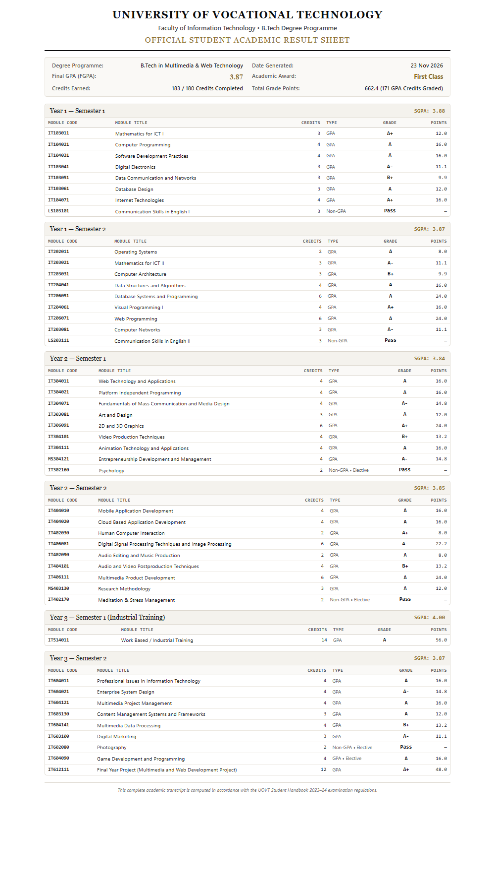

<div align="center">

# UOVT GPA Calculator

**A modern, privacy-first GPA calculator and academic result sheet generator for University of Vocational Technology (UOVT) B.Tech students.**

[](https://vitejs.dev/)
[](package.json)
[](https://uovt.ac.lk)
[](LICENSE)

<br />



</div>

---

## Overview

Designed specifically for students in the **Faculty of Information Technology** at the **University of Vocational Technology (UOVT)**, Sri Lanka.

Pre-loaded with every module code, title, and credit weighting from the official **Student Handbook 2023–24**, this calculator allows students to track semester performance, plan future targets, and export a clean, printable official **Academic Result Sheet (PDF)**.

### ✨ Highlights

- **Direct Grade Entry**: Seamlessly select letter grades (`A+` down to `F`, `Pass`, `I`) matching official university transcripts.
- **Real-Time GPA Engine**: Computes Semester GPA (**SGPA**) and Final Cumulative GPA (**FGPA**) weighted by credits and rounded to 2 decimal places.
- **One-Click PDF Result Sheet**: Generates an institutional-style transcript with university letterhead, completed semesters, SGPA badges, and degree award standing.
- **Target Class Planner**: Mathematically determines the exact average grade points required on your remaining credits to secure a target class (*First Class*, *Second Upper*, etc.).
- **Amber & Ink Theme**: A dark scholarly interface with sticky sidebar navigation, collapsible year/semester accordions, and high typographic contrast.
- **100% Private & Offline**: Zero tracking, zero accounts, and zero cloud databases. All entered grades persist securely in your browser's `localStorage`.

---

## Supported Programmes

Pre-configured with all 6 semesters and 167 compulsory GPA credits:

| Degree Programme | Short Code | Compulsory Credits |
| :--- | :---: | :---: |
| **B.Tech in Multimedia & Web Technology** | `MWT` | 167 GPA Cr. |
| **B.Tech in Software Technology** | `ST` | 167 GPA Cr. |
| **B.Tech in Network Technology** | `NT` | 167 GPA Cr. |

> *Custom modules can be added to any semester at any time.*

---

## Academic Grading Scale

Accurately modeled from the **UOVT Student Handbook (2023–24)**:

| Grade | Points | Classification Floor |
| :---: | :---: | :--- |
| **A+ / A** | `4.0` | **First Class**: $\text{FGPA} \ge 3.70$ |
| **A−** | `3.7` | **Second Class (Upper Division)**: $3.30 \le \text{FGPA} \le 3.69$ |
| **B+** | `3.3` | **Second Class (Lower Division)**: $2.70 \le \text{FGPA} \le 3.29$ |
| **B** | `3.0` | **Ordinary Pass**: $2.00 \le \text{FGPA} \le 2.69$ |
| **B−** | `2.7` | **Graduation Requirement**: Min. 180 total credits & $\text{FGPA} \ge 2.00$ |
| **C+** | `2.3` | *Non-GPA (NG) and elective modules with no entered grade are excluded from calculations.* |
| **C** | `2.0` | |
| **C−** | `1.7` | |
| **D+** | `1.3` | |
| **D** | `1.0` | |
| **F** | `0.0` | |
| **Pass / I** | `—` | *Pass earns module credits toward graduation but is excluded from GPA denominator.* |

$$\text{SGPA} = \frac{\sum (\text{Credits} \times \text{Grade Points})}{\sum \text{Credits}}$$

---

## Getting Started

### Prerequisites

- [Node.js](https://nodejs.org/) (version 18 or higher recommended)

### Installation & Run

```bash
# 1. Clone the repository
git clone https://github.com/supunngunarathna93/GPA-Calculater-Uovt.git

# 2. Navigate to project root
cd GPA-Calculater-Uovt

# 3. Install dependencies
npm install

# 4. Start the development server
npm run dev
```

Open your browser at `http://localhost:5173`.

### Production Build

```bash
npm run build    # Compiles production-ready bundle to /dist
npm run preview  # Previews production build locally
```

---

## Project Structure

```text
├── index.html                   # Entry page shell
├── package.json                 # Project configuration & scripts
├── vite.config.js               # Vite build configuration
├── src/
│   ├── main.js                  # Application runtime, DOM rendering & event handling
│   ├── data.js                  # Complete UOVT module catalogues for all 3 B.Tech degrees
│   ├── gpa.js                   # Pure GPA mathematical engine & academic award evaluator
│   └── style.css                # Custom design system tokens & print styles
└── UOVT_Academic_Result_Sheet.pdf # Sample generated official result sheet
```

---

## License

This project is licensed under the [MIT License](LICENSE).

<div align="center">
  <sub>Built with precision for UOVT B.Tech undergraduates.</sub>
</div>
